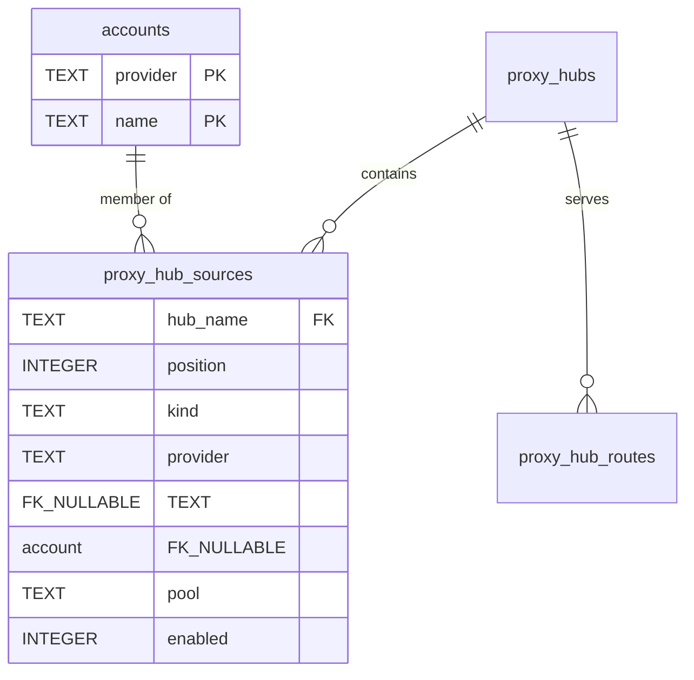

# ADR-0029: Relational hub membership with value-based route pins

- Status: accepted (2026-09-21)
- Provenance: a renamed account left `workbuddy/outof0` in hub `default`
  while the account no longer existed. The snapshot hides it (it iterates
  live accounts), serving resolved it and failed every request through the
  hub with `no snapshot for workbuddy/outof0`, and removing a source by
  slice surgery silently re-pointed positional pins. Three layers of
  application code (prune-on-delete, ghost rows, skip-on-resolve-fail) now
  contain the damage; this record moves the guarantee into the schema.

## Context

Hub membership lived in one place: the `sources` array inside the
`config_json` document of `proxy_hubs`, with route pins stored as positional
`SourceIndex` into that array (`proxy_hub_routes` manifests). JSON documents
take no foreign keys, and positions shift on removal, so:

- deleting/renaming an account left ghosts no layer could see (snapshot
  iterates live accounts; preview printed pins without validating them);
- removing a source re-pointed every later pin at the wrong account;
- one ghost failed every request (serve aborted the chain on resolve error).

The schema already enforces this shape elsewhere: `account_snapshot_files`
references `accounts(provider, name)` ON DELETE CASCADE, and
`proxy_hub_routes` references `proxy_hubs(name)` the same way, with
`PRAGMA foreign_keys = ON`. Hub sources were the exception for legacy
reasons (TypeScript codec parity on `config_json`).

## Decision

- New `proxy_hub_sources` (owned by `internal/hub`), one row per member:
  `PRIMARY KEY (hub_name, position)`,
  `FOREIGN KEY (hub_name) REFERENCES proxy_hubs(name) ON DELETE CASCADE`,
  `FOREIGN KEY (provider, account) REFERENCES accounts(provider, name)
  ON DELETE CASCADE`.
- Pool refs (`pool:<provider>`) are members of a pool, not an account: they
  persist as rows with `kind = 'pool'` and NULL provider/account, which
  SQLite skips in FK enforcement. Account rows use `kind = 'account'`.
- `config_json` keeps its exact TypeScript wire shape (sources included):
  the single writer composes it from the same in-memory Config, so no
  reader — Go, Swift, or Tauri protocol — observes a change. Rows are
  authoritative on read; the document stays byte-compatible.
- Route pins change from positional `SourceIndex` to value `Owner`
  (`"provider/account"`, pool refs as `"pool:<provider>"`). Positions rot;
  values resolve against the current member list and miss visibly instead
  of hitting the wrong account. Legacy indices resolve bounds-checked as a
  fallback for rows the migration never saw.
- Migration backfills rows from `config_json` (position = order, explicit
  enabled flag), converts manifest pins index→value, and drops ghosts
  (sources without accounts, pins without sources). Downgrade is refused by
  the existing `SCHEMA_NEWER` guard, so no old binary can widen the gap.

## Consequences

- Deleting an account cascades its hub membership at the database level;
  renames (delete + save) need no hub-aware code on the account side.
- Pins can no longer re-point: there is no index to shift. Removal only
  ever drops pins that named the removed member.
- Application guards stay: prune-on-delete reports what vanished,
  ghost-row/snapshot and skip-on-resolve-fail cover manifests and transient
  failures the schema cannot see. Belt and braces, documented as such.
- `config_json` sources duplicate the rows by design (wire compat); the
  duplication lives in exactly one writer (`upsertConfigLocked` + row sync)
  and one reader (rows win, document ignored).
